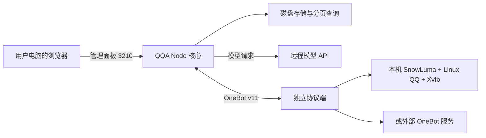

# QQA Linux 服务器适配与 2 核 2G 优化规划

日期：2026-10-12。状态：源码实现、独立审查及审查修复已完成；服务器构建、存储迁移、认证、资源边界和扩展框架已通过 Windows 与目标 ECS 的隔离 Linux 测试。新版已切换生产并验证 QQA、SnowLuma 与 QQ 登录窗口，旧程序已清理，保留一份回滚备份，详见 [实际部署记录](../../构建产物/部署资料/server-deployment-20261012.md)。本人首次设置、Hook/真实 QQ 收发和 24 小时资源验收仍待完成，不能据模拟测试宣称这些项目通过。

当前实现基线：核心固定 Node.js 22.17.1（最低 22.16），绑定 `server-2c2g` 预设；仓库原有 `skills/` 与 `plugins/` 已移除，用户可通过 Skill 市场安装到可写数据目录，`src/skills/` 核心框架保留。最终完整测试共 **123 项**：Windows **118 通过、5 个 Linux 专项跳过、0 失败**；目标 ECS 隔离 Linux **123 通过、0 跳过、0 失败**。详情、复现命令和尚未完成的真实验收见 `server-2c2g-implementation.md` 与 `server-2c2g-review.md`。

目标是在无桌面的 Linux 服务器上，通过浏览器管理 QQA，并让单 QQ 账号、少量白名单群在 2 核 2G 机器上稳定运行。保留消息收发、人设、记忆、搜索、表情、提醒和用量记录，重做桌面操作入口、协议端管理及资源策略。

## 1. 阅读依据与结论

| 对象 | 本次阅读基线 | 用途 |
| --- | --- | --- |
| [K0nd1us/QQ-agent](https://github.com/K0nd1us/QQ-agent) | `11577baad321d1774caf0765d791c211072bfa83`，package 版本 `0.4.0` | 理解原始桌面架构、OneBot 客户端、扩展机制和测试脚手架 |
| [prolet1966/QQ-Agent-for-Linux](https://github.com/prolet1966/QQ-Agent-for-Linux) | `da6f0560c1c7530a985bb4c1542a88cae104b80e`，package 版本 `0.4.7` | 后续实际修改的开发仓库 |
| 当前 ECS | Ubuntu 22.04.5、x86_64、2 vCPU | 只读采集部署状态及资源基线 |

核对了 README、运行入口、配置加载、QQ/SnowLuma 启停、HTTP/SSE、OneBot、消息与会话存储、编排与发送队列、扩展加载、媒体处理及 Linux 构建流程。该范围覆盖服务器运行的主要链路；第三方原生协议组件的内部实现与全部扩展的实际效果仍需运行验证。

上游和 Linux 仓库都已有 `src/server.js`，可用纯 Node 启动核心。Linux 移植已完成 XDG 数据路径、Linux QQ 探测、SnowLuma Linux 运行时及可写镜像等工作。**下一步应复用这些能力，把桌面发行形态改为真正的服务器运行形态。**

两个仓库的版本号及源码已有差异，不能把上游 `main` 直接覆盖到 Linux 仓库。后续在 Linux 仓库做增量修改，需要的上游修复逐项移入，保留原作者署名与许可证。

## 2. 当前服务器的实测基线

采样时间：2026-10-12 01:39–01:42，Asia/Shanghai。采样时 OneBot 未连通，尚未运行正常机器人负载。

| 项目 | 只读检查结果 |
| --- | --- |
| CPU | 2 vCPU |
| 系统可见内存 | `free -m` 报告 1736 MiB；不能按完整 2048 MiB 制定预算 |
| 当时可用内存 | 约 767 MiB，包含可回收缓存 |
| Swap | 1024 MiB，当时使用 0 MiB |
| QQA / Electron | 6 个进程，合计 PSS 约 286 MiB |
| Linux QQ | 7 个进程，合计 PSS 约 220 MiB |
| SnowLuma Node | 1 个进程，PSS 约 102 MiB |
| Xvfb | 1 个进程，PSS 约 26 MiB |
| 上述应用进程合计 | PSS 约 635 MiB，未包含操作系统及其他服务 |
| 当前端口 | QQA `0.0.0.0:3210`；SnowLuma WebUI `127.0.0.1:5099`；QQ `127.0.0.1:9210` |
| OneBot | 未监听默认 3000/3001，连接报 `ECONNREFUSED 127.0.0.1:3001` |
| 版本 | Linux QQ `3.2.34-53644`；SnowLuma `1.14.19`，使用其自带 Node |
| 注入权限 | `kernel.yama.ptrace_scope=1`；这是需核对的限制，尚不能据此认定注入失败 |
| 近期 OOM | 本次读取的近两天内核日志未发现 OOM 记录 |

PSS 按共享内存比例分摊，适合比较多进程应用的实际开销。RSS 不应简单相加后当成独占内存。上述数字是一次未连通状态下的采样，不能证明高负载稳定，也不能视为优化后的表现。

### SnowLuma 的已知状态

SnowLuma 已运行，当前问题发生在 WebUI、QQ 接入与 OneBot 就绪之间：

- 日志提示 `awaiting EULA/PRIVACY consent before the panel unlocks`。
- `webui.json` 中 `mustChangePassword=true`，初次管理流程尚需处理。
- `runtime.json` 中 `hookAutoLoad=false`。
- 本次检查的配置目录仅有 `runtime.json`、`webui.json`，尚无账号专属 `onebot_<uin>.json`。
- `ldd` 检查对应 `.so` 未发现缺失的动态库；这不等同于原生模块、Node ABI 或 QQ 钩子已经兼容。

目前没有足够证据把故障归结为“SnowLuma 不支持服务器”或“只有未登录”。需进一步验证条款确认、密码修改、Hook 加载、QQ 登录、版本兼容与权限。条款确认和扫码应由用户本人在可访问的界面完成，程序不代替用户接受协议。

## 3. 已确认需要修改的地方

| 问题 | 源码位置 | 服务器适配方向 |
| --- | --- | --- |
| 发行包仍以 Electron 桌面壳为主 | `package.json`、`electron/main.js`、`scripts/03-stage.sh` | 增加纯 Node 服务器包和入口，服务器上不启动 QQA 的 Chromium 窗口与托盘 |
| 仓库源码仍固定监听回环，来源验证只接受本机 | `src/app.js` 的 `listenOn()`、`originAllowed()` | 纳入之前临时公网修复，提供绑定地址、精确允许来源和真正的登录认证 |
| 端口冲突时自动改为 3211 等端口 | `src/app.js` 的 `start()` | 服务器模式固定 3210；冲突明确报错，避免用户继续访问错误端口 |
| `server.token` 无法直接让现有浏览器流程完整工作 | `src/app.js`、`ui/app/00-core.js`、`ui/app/02-sse-sessions.js` | 统一普通请求、SSE、图片和下载的认证；前端固定标记不是密码 |
| SnowLuma WebUI 在服务器执行 `xdg-open` | `src/routes.js`、`src/platform.js`、`ui/app/03-snowluma.js` | 改为客户端浏览器可用的管理入口；不能把服务器的 `127.0.0.1` 原样当成远程链接 |
| 端口未开被诊断成未登录；探测固定使用回环 | `src/routes.js` 的 `/api/status`、`src/app.js` 的 OneBot 轮询 | 拆分进程、WebUI、Hook、账号与协议状态；外部协议端探测实际配置的地址 |
| 启动成功目前主要表示已 spawn 或端口被占用 | `src/app.js` 的 `launchSnowluma()` | 等待真实就绪、识别进程身份、记录启动错误与退出原因，防止端口误判 |
| SnowLuma 停止接口未等待异步函数 | `src/routes.js` 的 `/api/snowluma/stop` | `await` 停止完成后返回实际结果，处理超时和失败 |
| Headless 入口仅为 SIGINT 注册完整关闭流程 | `src/server.js`、`src/instance-lock.js` | 支持 SIGTERM 和幂等优雅退出，确保停止时保存数据、关闭连接并释放锁 |
| 聊天数据全量常驻，收到消息会同步重写整个群 JSON | `src/store.js` | 分离磁盘历史与内存工作集，改为增量持久化和分页读取 |
| 启动即扫描用量档案，索引与统计缓存可随历史增长 | `src/app.js`、`src/sessions.js` | 持久化统计摘要，按需增量查询，限制内存缓存 |
| 扩展加载仍会导入入口，默认开启热重载 | `src/plugin-loader.js`、`src/config.js` | 扫描清单与执行模块分离；服务器仅加载启用且兼容的扩展，关闭默认热重载 |
| 记忆整理、插件 Worker、媒体处理有独立任务来源 | `src/orchestrator.js`、`plugins/kb-growth/`、`plugins/memory-growth/` | 纳入统一资源队列，聊天优先，后台任务限并发 |
| 部分功能依赖 Electron 或本地计算 | `skills/help-board/`、`plugins/speech-to-text/`、媒体模块 | 帮助菜单走文本降级；本地语音识别、视频转码按需启用 |
| CI 的应用代码来自旧归档而非直接从 checkout 构建 | `.github/workflows/build-linux-arm64.yml`、`ci-input/app-code.tar.gz` | 服务器流水线直接消费当前源码与锁文件，记录提交号，避免修改源码但发布旧代码 |

之前服务器上的 `bindHost/publicHost` 修复尚未进入开发仓库；该修复只处理监听与来源检查，没有实现用户登录认证。后续要完整落入源码并回归浏览器功能。

## 4. 建议的运行形态

图中本机与外部协议端是两种可选配置；同一个 QQA 实例只连接所选账号的协议端。

### 默认方案：本机单账号服务器模式

QQA 核心用经过验证的 Node LTS 直接运行；服务器包不携带或启动 QQA 的 Electron 壳。Linux QQ 仍然有自己的图形运行需求，使用 Xvfb 提供显示，首次登录使用协议端支持的扫码入口或临时可见会话。**去掉 QQA 的 Electron 不会让 QQ 本体自动变成无桌面程序。**

QQ、SnowLuma 和 QQA 分别管理生命周期，重启 QQA 核心不重新启动已登录 QQ。控制台显示各组件的就绪状态，仅操作明确归属于本实例的进程。外部进程可以检测，但不能仅凭名称或端口占用就认领和结束它。

核心 Node 与 SnowLuma Node 分别固定版本。本轮核心已固定并验证 Node 22.17.1，最低 22.16；SnowLuma 1.14.22 使用官方包自带 Node 22.13.0，避免随意换成系统 Node 或 Electron Node 后出现原生 ABI 问题。二者已在目标 Ubuntu 上作为独立服务运行；Hook与真实收发仍待验收。

### 可选方案：外部 OneBot

允许配置远程 HTTP/WS 地址及各自令牌，跳过本机 QQ、SnowLuma 目录探测、令牌自动同步与启停。此时 QQA 更轻，控制台也应显示“外部协议端”，不再提示“启动 SnowLuma”。

外部协议端的媒体路径属于远端机器；收图、语音、视频应优先使用协议端返回的可下载 URL 或经过验证的传输接口，不能在 QQA 服务器读取远端本地文件路径。

保留 SnowLuma 接入，先验证它的实际登录和收发链路。NapCat 可作为兼容候选另做实测；上游 `setup:napcat` 下载的是 Windows 资产，不能直接作为 Linux 安装器，也不能预先保证换协议端会更省内存。

### 浏览器与 SnowLuma 管理

QQA 保持通过 IP 加 3210 访问，无需域名或宝塔。新增登录页、密码校验、会话过期与登出，使用同源会话认证覆盖 API、SSE、图片与下载；保留来源检查和配置脱敏。

SnowLuma 管理入口优先验证经过 QQA 登录保护的固定代理入口，测试其绝对资源路径、Cookie、跳转、API 与 WebSocket 是否支持代理。若不能可靠代理，则使用 SSH/Workbench 本地转发访问其原生 WebUI，不假装该功能已经兼容。SnowLuma 保持内部监听，不为此要求再公开多个端口。

用户可以在该入口完成条款阅读、改初始密码、加载 Hook 与扫码。若协议端没有可用扫码接口，明确提供临时远程显示方式，登录后关闭临时显示服务；不默认常驻完整桌面或 VNC。

公网 HTTP 的登录认证解决访问控制，无法提供传输加密。服务器包可提供内置 HTTPS 或通过加密隧道访问的选择，不把 Nginx、宝塔或购买域名作为运行前提。

## 5. 2 核 2G 预设与资源优化

新增明确选择的 `server-2c2g` 预设。配置优先级为显式环境变量 > 用户配置 > 所选预设 > 通用默认值。保存用户配置与计算运行时有效配置分开处理，环境变量里的密钥不写回配置文件。旧配置中已明确设置的值在迁移时保留，并显示与资源建议冲突的项。

以下是拟新增的策略或默认值，**不是当前源码已经支持的完整配置字段**：

| 项目 | 预设策略 |
| --- | --- |
| QQ 账号 | 默认运行 1 个账号 |
| Agent 并发 | `maxConcurrentRuns=1`，保留按群聚批和白名单 |
| 待运行群队列 | 初始上限 32 个；合并同群触发，满载时保留已持久化的未读消息并展示排队状态 |
| 模型后台任务 | 记忆整理与自动提取共享限流器，低优先级执行，避免绕过聊天并发限制 |
| 热重载 | `extensions.hotReload=false`；修改扩展后手动刷新或重启 |
| MongoDB | 显式关闭自动自举；依赖它的自增长扩展默认关闭，普通本地记忆继续可用 |
| 用量预热 | 禁止启动时全量预热历史，改为读取摘要、按需增量补算 |
| 主动找聊、定时扫描 | 重型主动后台功能默认关闭；用户设置的提醒仍保留，并避免断线后集中重放 |
| 本地语音识别 | 默认关闭 whisper，本机不加载语音模型；远程识别可按需配置 |
| 视频处理 | 默认元信息模式，不默认转码和抽帧；启用后全局最多 1 个媒体子进程，限制线程、时长与输入体积 |
| 图片能力 | 保留远程视觉 API；下载体积、同时处理数量与缓存分别设上限 |
| Electron 图片菜单 | 服务器模式使用文本菜单；不为菜单截图再常驻 Chromium |
| 插件与 Skill | 按用户后续要求，删除仓库内全部 bundled 模块，保留核心框架和 Skill 市场；用户选装后才启用执行 |
| 日志与临时媒体 | 按天和总字节数滚动，缓存设置 TTL 与总容量；不只限制日志行数 |

并发 1 只能限制一类任务，不能单独解决所有资源问题。消息接入、LLM、后台整理、发送、媒体子进程均需有明确队列与容量。连接重试继续保留现有代际互斥，并加入退避抖动，避免协议端离线时形成重连风暴。

### 存储方案

服务器后端建议使用 SQLite WAL 保存聊天消息及必要索引；复杂查询与迁移放在单独 Worker，数据库缓存设预算，不在 HTTP 主事件循环做大批同步扫描。驱动选择需在目标 Node LTS 和 Ubuntu 22.04 x64 上先验收，服务器发行包固定运行时和依赖。

已实现 JSON 兼容后端，已有 JSON 目录继续使用 JSON；新空目录自动使用 SQLite。旧历史 SQLite 切换是独立迁移步骤，不随首次启动偷偷改写全部历史。

关键规则：

1. 保持存储接口语义，覆盖最近消息、未读、撤回、按消息 ID 查询、补媒体和分页存档。若改为异步查询，逐一调整所有调用者与扩展接口。
2. 磁盘保留历史，内存只缓存最近工作集。初始预算为最多 8 个热会话、每个最多 500 条缓存消息，另设总字节上限；不通过删历史来达成内存目标。
3. 不把 `maxMessagesPerChat` 或 `keepSessionFiles` 改成会删除旧数据的默认值。保留期限由用户另行设置，先提供导出和归档。
4. 迁移保留 local ID、QQ 消息 ID（包括负数或空值）、next ID、时间、未读、撤回及媒体字段；源 JSON 保留备份，数量与关键字段校验成功后才切换。
5. 迁移大 JSON 文件时限制内存，使用流式解析或有边界的迁移工具，不在核心进程一次装入所有群历史。
6. 会话详细记录继续按需从磁盘读取；用量统计保存增量摘要，结束会话时更新，不在每次打开用量页重扫全部详细记录。
7. 回滚前支持导出迁移后新增数据到旧格式；只恢复旧备份会丢失升级后的新消息，不能当作完整回滚。

### HTTP、SSE 和媒体内存

- 为慢 SSE 客户端处理 `res.write()` 背压；合并会话进度更新，限制每个连接的待发字节与连接总数，超限允许断开后重新获取快照。
- 会话更新优先传摘要或增量，打开详情时再读取完整内容，避免每次推送整个不断增长的会话。
- 为成员昵称、回复、历史统计及扩展缓存加 TTL/LRU 与字节上限，已结束任务及时释放监听器与定时器。
- 尽量流式下载、上传；必须发送 base64 的协议路径设置体积上限，核算 Buffer、base64 字符串及 JSON 序列化的重复开销。
- 限制 OneBot WS 消息体和 HTTP 请求体，拒绝超限时给出诊断；重连不能不断重新吞入同一个超大事件。

### 第一轮验收预算

以下为待实测的工程目标，不是已有性能承诺：

| 指标 | 初始目标 |
| --- | --- |
| QQA 核心及其 Worker 空闲 PSS | ≤150 MiB |
| QQA 核心及其 Worker 正常负载 PSS | ≤256 MiB |
| 本机 QQ + SnowLuma + Xvfb + QQA 正常负载合计 PSS | ≤1000 MiB |
| 正常负载系统 `MemAvailable` | ≥256 MiB |
| 控制台本机 API 响应 | 无外部查询的接口 P95 <500 ms |
| 持续运行 | 24 小时无 OOM、重复回复或持续增长的缓存/队列；Swap 不持续增长 |

先测量再设置 systemd 的 `MemoryHigh`、`MemoryMax` 与 CPU 配额。Node 堆上限不是总进程内存上限，Buffer、原生内存、Worker 和子进程要分别计入；不能靠极低的硬限额让服务反复被杀来宣称省内存。

## 6. 实施顺序与交付

### 阶段一：纯 Node 核心与远程控制台

修改 `src/server.js`、`src/app.js`、`src/config.js`、`src/routes.js`、前端 API/SSE 入口及 `package.json`。新增运行模式和能力查询，修复固定端口、监听地址、认证及优雅退出。桌面专属设置按运行能力隐藏或替换为服务器操作。

产出：不依赖 Electron 或 DISPLAY 的 QQA 核心，可以在浏览器通过 3210 登录管理；使用 mock OneBot 验证消息链路。

### 阶段二：QQ / SnowLuma 服务器接入

将 QQ/SnowLuma 的进程控制与诊断从 `src/app.js` 抽成独立组件，修改 `src/platform.js`、`src/routes.js`、`src/onebot-accounts.js` 和 `ui/app/03-snowluma.js`。

启动前检查可执行文件、平台架构、运行时版本、数据目录、显示环境、同用户进程与注入条件。提供明确状态：未安装、启动中、等待配置、等待登录、Hook/权限异常、协议就绪、断线重连。端口占用仅作为探测信号，不当作组件身份或登录证据。

先贯通 WebUI 初次管理流程，再验证 QQ 登录、账号端点发现、OneBot 查询与真实收发。发生明确注入权限错误后再评估最小权限解决方案，不默认关闭全局 ptrace 限制、QQ 沙箱或改成 root 运行。

产出：这台服务器实际完成一个账号的收发，断线和组件重启有可解释状态；QQA 重启不会破坏 QQ 登录态。条款确认、改密码和扫码需要用户本人操作。

### 阶段三：2G 资源策略与数据优化

修改 `src/store.js`、`src/sessions.js`、`src/orchestrator.js`、`src/sender.js`、`src/plugin-loader.js`、`src/skills/manager.js`、媒体与日志模块，增加存储后端、迁移工具、资源队列和服务器预设。

优先保证文字聊天与管理面板，再逐项验证图片、表情、提醒、搜索及记忆。按用户后续要求，删除原 bundled Skill/插件，保留框架和市场，让用户自行选择兼容模块；禁用的模块不执行 setup。

产出：受控缓存和任务队列、可回滚的数据迁移、资源监控与按需启用的重型功能。

### 阶段四：服务器打包、迁移与稳定性验收

新增服务器构建脚本、Ubuntu x64 CI 和 systemd 单元模板。服务器包直接从当前 checkout 与锁文件构建，安装生产依赖，排除用户数据、密钥、运行日志和桌面运行时，保留现有完整性与依赖图门禁。

程序安装目录只读；配置、数据与扩展安装区可写。已把市场安装和加载路径调整到数据目录 `extensions/skills`、`extensions/plugins`；仓库原 bundled 目录已清空，防止非 root 服务安装扩展时出现 EACCES。

QQA、QQ、SnowLuma 分别由服务管理器负责，设置合理的失败退避与停止超时；不要同时让 systemd 和 QQA 自动拉起同一组件。通过受限的组件控制接口提供面板操作，避免给管理 API 任意执行系统命令的能力。

迁移前备份现有配置、记忆、消息、会话、协议端配置及 QQ 登录数据，保留属主和权限。先在独立数据目录验证服务器包，再安排线上切换。明确区分只切换运行入口、配置迁移和存储迁移的回滚方法。

产出：服务器安装包、启动/升级/回滚脚本、迁移说明、实测资源报告与新旧功能对照。

## 7. 验收方法与尚未确定的依赖

| 验收范围 | 必须证明的行为 |
| --- | --- |
| 无桌面运行 | 不安装 Electron、清空 DISPLAY 仍能启动 QQA 核心和浏览器控制台 |
| 远程访问 | IP:3210 登录成功；未认证请求被拒绝；SSE、媒体、下载能使用同一认证；错误来源仍被拒绝 |
| 服务生命周期 | SIGTERM 可完成保存和退出；固定端口冲突明确失败；单实例锁避免重复回复 |
| OneBot 兼容 | mock 正向 WS + HTTP 覆盖收发、令牌、掉线重连、外部地址和负数消息 ID；保持现有发送去重与白名单 |
| SnowLuma 实机 | WebUI 配置、Hook、QQ 登录、账号端点和一收一发均成功，不能只用页面返回 200 作为证明 |
| 数据兼容 | 迁移前后条数/ID/未读/撤回/记忆/用量一致；中断迁移可恢复；回滚可保留新增数据 |
| 扩展 | 禁用模块不执行 setup 或启动后台任务；帮助菜单无 Electron 时可用文本；缺依赖原因可见 |
| 低资源负载 | 2 vCPU、实际约 1736 MiB 内存环境；5 个白名单群合计 5 条/秒，另做 20 条/秒、60 秒突发；模拟模型和协议端避免压测真实 QQ 群或计费 API |
| 大历史与慢客户端 | 10 万条历史消息、5000 个会话记录；慢 SSE 连接、协议端离线、媒体任务与界面查询同时存在时仍有界限 |
| 持续稳定性 | 记录 PSS/RSS、Node heap/external、CPU、事件循环延迟、队列长度、可用内存、Swap、磁盘及 OOM；至少持续 24 小时 |

改造前 Linux `npm test` 只运行平台抽象测试。本轮已扩展到真实核心 mock 链路、存储、安全、资源、协议代理和发行/回滚测试，并在目标机器的隔离目录运行；真实 QQ 和持续资源验收仍单独执行。

尚需实测确定：SnowLuma 对当前 QQ 版本的钩子兼容性；完成初次 WebUI 配置后是否仍受注入权限影响；WebUI 能否可靠通过固定代理入口使用；协议端是否提供适合无桌面环境的登录接口；SQLite 驱动与既有扩展接口的兼容性；已登录 QQ 长时间运行的真实内存峰值。

推荐按阶段一至四推进。第一版优先完成“纯 Node 核心 + 3210 浏览器管理 + 单账号真实收发”，然后再交付存储迁移与完整 2G 资源优化，分别保留可验证、可回滚的结果。
